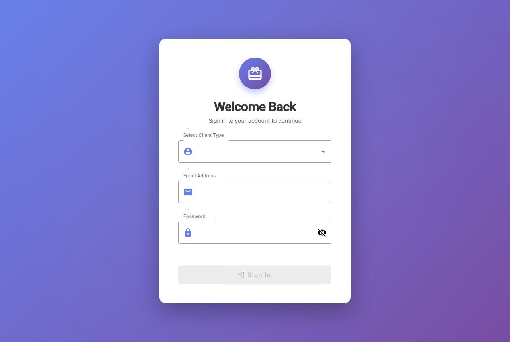

# Coupon System — Web Client

[](https://github.com/AhatSaraiah/CouponSystemWebsite/actions/workflows/ci.yml)
[](https://angular.io)
[](LICENSE)

Angular front end for a three-role coupon management system. Administrators manage companies
and customers, companies publish and retire coupons, and customers browse the store and buy
coupons. Each role gets its own navigation and its own guarded area of the app.

The client talks to a separate Java / Spring REST service (the backend of the Amdocs & Co-Impact
full-stack program); this repository contains the Angular application only.



## Features

**Admin**
- List and remove companies and customers
- Sign in through the shared login screen and land directly in the admin area

**Company**
- See every coupon the signed-in company owns
- Create a coupon with category, title, description, dates, amount, price and image
- Delete a coupon

**Customer**
- Browse the full store and the coupons already purchased
- Buy a coupon with a single action
- Switch between the store and "my coupons" views

**Across the app**
- Role-aware sidebar: each account type only sees the screens it can use
- Route guards keep an unauthenticated visitor, or the wrong role, out of protected screens
- The session survives a page refresh and is cleared on sign out
- Success and failure feedback through Material snackbars instead of blocking alerts
- One place to configure the API host (`src/environments/environment.ts`)

## Tech stack

| Layer | Choice |
| --- | --- |
| Framework | Angular 15 (standalone modules, strict TypeScript) |
| UI | Angular Material 15, Angular Flex Layout, custom CSS |
| Data | `HttpClient` + RxJS observables, typed models |
| Tests | Karma + Jasmine, `HttpTestingController` for the service layer |
| Tooling | Angular CLI 15, ESLint (`@angular-eslint`), GitHub Actions |

## Project structure

```
src/app/
├── core/
│   ├── models.ts               # Company, Customer, Coupon, categories, client types
│   ├── auth.guard.ts           # role-aware CanActivate guard
│   └── notification.service.ts # snackbar wrapper used by every feature
├── layouts/default/            # shell: header, role-based sidebar, sign out
├── login/                      # client-type select + credential form
├── admin-companies/            # admin: companies table
├── admin-customers/            # admin: customers table
├── company-coupons/            # company: coupon list + create form
├── customer-coupons/           # customer: store and owned coupons
├── admin.service.ts            # /admin endpoints
├── company.service.ts          # /company endpoints
├── customer.service.ts         # /customer endpoints
└── auth.service.ts             # current role, mirrored into sessionStorage
```

Every HTTP call is built from `environment.apiBaseUrl`, so moving the app between a local
backend and a deployed one is a one-line change.

## Getting started

Requirements: **Node.js 18** (see `.nvmrc`) and a running instance of the Coupon System backend.

```bash
git clone https://github.com/AhatSaraiah/CouponSystemWebsite.git
cd CouponSystemWebsite
nvm use            # or install Node 18 manually
npm ci
npm start          # http://localhost:4200
```

The backend is expected on `http://localhost:9096`. Point the app somewhere else by editing
`apiBaseUrl` in `src/environments/environment.ts` (development) or
`src/environments/environment.prod.ts` (production build).

## Scripts

| Command | What it does |
| --- | --- |
| `npm start` | Dev server with live reload on `http://localhost:4200` |
| `npm run build` | Development build into `dist/` |
| `npm run build:prod` | Optimised production build |
| `npm test` | Unit tests in watch mode |
| `npm run test:ci` | Unit tests, single run, headless Chrome (`ChromeHeadlessCI` launcher) |
| `npm run lint` | ESLint over the project |

## API contract

| Method | Endpoint | Service method |
| --- | --- | --- |
| GET | `/admin/loginAdmin/{email}/{password}` | `AdminService.adminLogin` |
| GET | `/admin/getAllCompanies`, `/admin/getOneCompany/{id}` | `AdminService.getCompanies`, `getOneCompany` |
| POST / PUT / DELETE | `/admin/addCompany`, `/admin/updateCompany`, `/admin/deleteCompany/{id}` | `AdminService.addCompany`, `updateCompany`, `deleteCompany` |
| GET | `/admin/getAllCustomers`, `/admin/getOneCustomer/{id}` | `AdminService.getAllCustomers`, `getOneCustomer` |
| POST / PUT / DELETE | `/admin/addCustomer`, `/admin/updateCustomer`, `/admin/deleteCustomer/{id}` | `AdminService.addCustomer`, `updateCustomer`, `deleteCustomer` |
| GET | `/company/loginCompany/{email}/{password}` | `CompanyService.companyLogin` |
| GET | `/company/getCompanyCoupons`, `/getCompanyCoupons/{category}`, `/getCompanyCoupons/{maxPrice}` | `CompanyService.getCompanyCoupons`, `getCompanyCouponsbyCategory`, `getCompanyCouponsbyPrice` |
| POST / PUT / DELETE | `/company/addCoupon`, `/company/updateCoupon`, `/company/deleteCoupon/{id}` | `CompanyService.addCoupon`, `updateCoupon`, `deleteCoupon` |
| GET | `/customer/loginCustomer/{email}/{password}` | `CustomerService.customerLogin` |
| GET | `/customer/getAllCoupons`, `/customer/getCustomerCoupons`, `/customer/getCustomerCoupons/{category}` | `CustomerService.getAllCoupons`, `getCustomerCoupons`, `getCustomerCouponsbyCategory` |
| POST | `/customer/addCouponPurchase` | `CustomerService.addCouponPurchase` |

Credentials are URL-encoded before they are placed in the path.

## Quality

- `npm run lint` passes with no warnings
- 35 unit tests covering every service endpoint, the login flow and the shell component
- CI runs lint, build and the headless test suite on every push and pull request to `master`
- Strict TypeScript and strict Angular templates: the models in `core/models.ts` are the single
  source of truth for the API payloads

## Known limitations and next steps

- **Credentials in the URL path.** The backend exposes login as `GET /{role}/login.../{email}/{password}`,
  so the password ends up in the request URL. Moving to `POST` with a JSON body (and a token in the
  response) is the next backend-driven change; the services are already isolated behind one method each,
  so the client side is a small edit.
- **Role-only session.** The app remembers the role, not a server session or token; the API is trusted to
  keep its own session state.
- **Native confirm dialogs.** Destructive actions still use `confirm()`. Replacing them with a Material
  dialog is planned.
- **No end-to-end suite yet.** `e2e/` is scaffolded and waiting for the first real scenario.

## License

[MIT](LICENSE) © Ahat Saraiah
